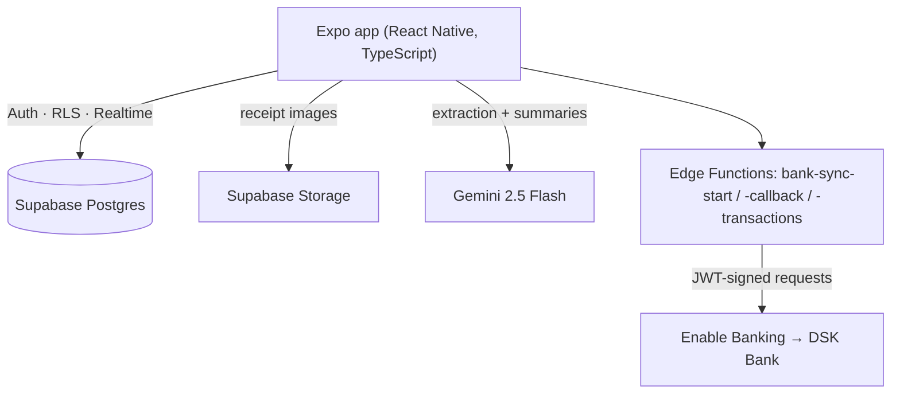

<p align="center">
  
</p>

<h1 align="center">Teftera · тефтера</h1>

<p align="center">
  AI-powered expense tracker for a shared two-person household.<br/>
  Receipt OCR · live bank sync · anomaly detection · <strong>€0/month running cost</strong>.
</p>

<p align="center">
  React Native (Expo SDK 56) · TypeScript strict · Supabase · Gemini
</p>

---

Teftera (Bulgarian: *тефтера*, "the ledger") is a personal daily-driver app and a
portfolio project. Two people share one household ledger that syncs in real time;
transactions arrive by manual entry, receipt photos read by Gemini, DSK Bank CSV
exports, or a live PSD2 bank connection. Everything runs on free tiers.

## Screenshots

<table>
  <tr>
    <td align="center"><br/>Dashboard</td>
    <td align="center"><br/>History</td>
    <td align="center"><br/>Insights</td>
    <td align="center"><br/>Receipt scanner</td>
  </tr>
  <tr>
    <td align="center"><br/>Confirm receipt</td>
    <td align="center"><br/>Manual entry</td>
    <td align="center"><br/>Budgets</td>
    <td align="center"><br/>Bank import</td>
  </tr>
</table>

## Features

- **Shared household ledger** — every table is scoped by `household_id` with Postgres Row Level Security; edits appear on the other phone via Supabase Realtime.
- **Receipt scanning** — camera capture → Supabase Storage → Gemini structured extraction (merchant, total, date, line items) → editable confirm screen. A bad model response always falls back to manual editing, never a crash.
- **DSK Bank CSV import** — ETL pipeline that parses the bank's export, normalizes rows, converts legacy BGN at the fixed EUR-transition rate (1 EUR = 1.95583 BGN, original amounts retained), auto-categorizes by merchant rules, and dedupes re-imports.
- **Live bank sync (PSD2)** — Enable Banking OAuth consent, then 90-day transaction pulls through three Supabase Edge Functions that hold the signing key server-side; the feed reuses the same ETL/dedup/preview pipeline as CSV.
- **Anomaly detection** — per-category Z-score over household history runs after every save; outliers get a lime accent in the ledger and a review flow on Insights.
- **AI monthly summary** — Gemini turns the month's aggregates into a 2–3 sentence natural-language insight (session-cached, refreshed on pull).
- **Budget goals** — per-category monthly budgets with progress bars and a local notification at 80% / over budget.
- **PDF monthly report** — dark-themed report with category donut, generated on-device with `expo-print` and shared via the system sheet.
- **Offline-aware, crash-resilient** — connectivity banner with disabled network actions; route-level error boundaries keep navigation alive.

## Architecture



```
/app                 Expo Router screens ((auth), (app) tabs, modals)
/features            Feature slices: transactions, receipts, insights,
                     budgets, anomalies, reports, household, auth
/services            Integration seams — supabase.ts, gemini.ts,
                     dsk-import.ts, bank-sync.ts, anomaly.ts
/lib                 Pure helpers: formatCurrency, categories, dates
/supabase            SQL migrations + Edge Functions (Deno)
/scripts             Tooling (app-icon generator)
```

All AI and bank logic sits behind `services/` modules. Gemini calls already run
server-side (`supabase/functions/gemini-extract`/`gemini-summary`); the anomaly
model is the remaining piece planned to move to a Cloud Run FastAPI microservice.

### Conventions

- TypeScript strict, no `any`, no `.js` source files.
- **Money is integer euro-cents.** No float arithmetic; all display goes through
  `lib/formatCurrency.ts`. Imported rows keep `original_amount` and
  `original_currency` (BGN) from before Bulgaria's 2026 euro adoption.
- All Gemini calls go through `services/gemini.ts` only; JSON parsing is always
  wrapped and falls back to manual entry.
- Design tokens (colors, type, spacing) live in `tailwind.config.js`. The anomaly
  accent `#c3f400` is used only on flagged transactions.

## Environment

Client (`.env`, gitignored — `EXPO_PUBLIC_*` are embedded in the bundle at build time):

| Variable | Purpose |
|---|---|
| `EXPO_PUBLIC_SUPABASE_URL` | Supabase project URL |
| `EXPO_PUBLIC_SUPABASE_ANON_KEY` | Supabase anon (publishable) key |
| ~~`EXPO_PUBLIC_GEMINI_API_KEY`~~ | **No longer used by the app.** Gemini calls moved server-side (see below) — the client never reads a Gemini key. Safe to delete from `.env` once the rebuilt dev client is verified working. |

Edge Function secrets (`npx supabase secrets set`, never in the repo):
`EB_APP_ID` · `EB_PRIVATE_KEY` (base64-encoded PEM) · `EB_ASPSP_NAME` ·
`EB_ASPSP_COUNTRY` · `EB_REDIRECT_URL` · `EB_STATE_SECRET` · `GEMINI_API_KEY`
(read by `supabase/functions/gemini-extract` and `gemini-summary` — the API key
now lives only server-side, never in the client bundle)

## Getting started

```bash
npm install
cp .env.example .env          # fill in the two EXPO_PUBLIC_* values
npx supabase db push          # apply migrations to your Supabase project
npx expo start                # dev server (Expo Go or a dev client)
```

Device builds go through EAS:

```bash
eas build --profile preview --platform android   # internal-distribution APK
eas build --profile preview --platform ios       # dev-signed, sideload via AltStore
```

> **Native dependency added — rebuild your dev client once.** This branch adds
> `react-native-keyboard-controller` (keyboard-aware scrolling on manual entry /
> confirm receipt), which is a native module — a plain Expo Go / JS-only reload
> is not enough. Run `eas build --profile preview --platform android` (or
> `npx expo run:android` for a local build) once before running this build,
> otherwise the app fails to load with a native-module-not-found error.

## Testing

```bash
npm test            # jest-expo — colocated *.test.ts unit tests
npx tsc --noEmit    # strict typecheck
npm run lint
```

Unit coverage concentrates on the pure core: currency parsing/formatting,
BGN→EUR conversion, DSK ETL normalization, dedup, category rules, anomaly
Z-score, report data, budget progress, network-state derivation.

## More

- Design specs and implementation plans for every feature live in
  [`docs/superpowers/`](docs/superpowers/) — the project is built spec-first.
- The portfolio narrative (what was interesting to build and why) is in
  [`docs/portfolio-writeup.md`](docs/portfolio-writeup.md).
