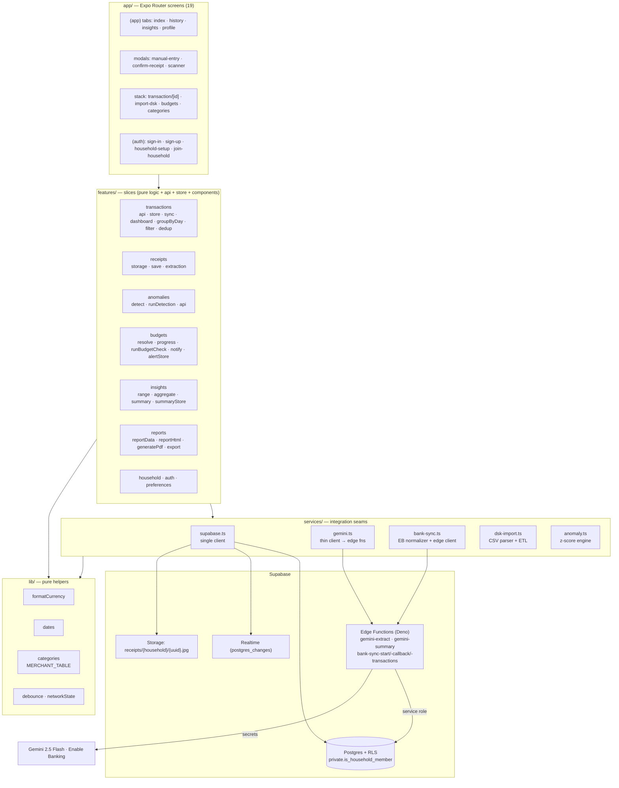

# Teftera — Architecture Map & Code Audit (2026-09-10)

Full-codebase read at `main` @ `6eef5bc` plus the planned-feature spec
`docs/specs/2026-09-09-vendors-loyalty-shopping-lists.md`. Nothing here was changed; this
is a map, a findings list, and a fix plan.

**Baseline.** The previous review (`docs/code-review-2026-07-18.md`) is effectively closed:
of its 13 numbered items, 12 are implemented on `main` (server-side Gemini, auth failure
path, extraction validation, structured output, windowed + debounced fetch, import-time
dedupe, EB income counterparty, zero-row filter, unified merchant table, token-refresh
skip, `useFocusEffect` clock, screen extraction, `truncated` flag). Only the
orphan-receipt RPC remains an accepted trade-off. This document is the next layer down:
duplication, dead paths, performance and structure that the next three features would
otherwise build on top of.

Size for orientation: **9.5k lines of app + edge code, 3.0k lines of tests in 44 files**,
19 screens, 11 feature slices, 5 services, 13 migrations, 5 edge functions.

---

## 1. Architecture map

### 1.1 Layers



### 1.2 Runtime flow (what actually happens)

1. **Boot** — `app/_layout.tsx` loads fonts, mounts `useAuthBootstrap` (subscribes to
   `onAuthStateChange`, applies the session, resolves the household via
   `getMyHousehold`) and `useProtectedRoute` (pure `resolveRedirect` decides the group).
   Status `error` renders `AuthErrorScreen` with a retry.
2. **Household data sync** — `app/(app)/_layout.tsx` mounts `useTransactionsSync` and
   `usePreferencesSync`. The former loads categories + 12-month transactions + open
   anomalies into `useTransactionsStore`, loads budgets into `useBudgetsStore`, and
   opens one realtime channel on `transactions`; any change → debounced (400 ms) full
   reload. This is the app's single source of truth for every screen.
3. **Reads** — screens never query; they select from the stores and derive with
   pure, tested helpers (`dashboard.ts`, `groupByDay.ts`, `filter.ts`, `range.ts`,
   `aggregate.ts`, `budgets/resolve+progress`). Insights' AI summary is session-cached in
   `summaryStore` and only regenerated on pull-to-refresh.
4. **Writes** — four entry paths converge on `features/transactions/api.ts`:
   manual entry, receipt (`scanner` → Storage upload → `confirm-receipt` → Gemini edge
   function → `saveReceiptTransaction`), DSK CSV (`dsk-import.ts` ETL), and live bank
   sync (`bank-sync.ts` normaliser → same ETL/dedupe/preview). After a save the screen
   runs the **post-save hooks**: `refreshTransactions`, `runDetection` (z-score →
   `anomalies` row + `is_flagged`), `runBudgetCheck` (80 %/100 % local notification with
   AsyncStorage dedupe).
5. **Server** — RLS on every table via the `private.is_household_member(uuid)`
   SECURITY DEFINER helper; the client never sees a secret. Edge functions resolve the
   caller's household with the service role, then call Gemini / Enable Banking.

### 1.3 Cross-cutting conventions that hold today

- **One I/O module per table** (`features/<x>/api.ts`) with explicit column lists.
- **Dependency-injected orchestration** (`runDetection`, `runBudgetCheck`,
  `refreshSummary`, `saveReceiptTransaction`, `exportMonthlyReport`) — the reason 44
  test files exist without mocking React Native.
- **Zustand stores are dumb**: `setData` / `reset`, no async inside stores; sync hooks
  own loading.
- **UI kit** (`components/`): `Screen`, `BottomSheet`, `ConfirmSheet`, `SheetActions`,
  `FloatingActionBar`, `SegmentedToggle`, `FlatInput`, `EmptyState`, `PillButton`.

### 1.4 Where the planned features plug in

| Planned piece | Reuses | Adds | Touches a weak spot below |
|---|---|---|---|
| `features/vendors` (aliases, autocomplete) | sync-hook pattern, `BottomSheet`/`SheetActions`, `EmptyState`, the DSK `normalizeMerchant` seam | 2 tables, 2 screens, `VendorAutocomplete`, conflict sheet | **D1** (a third post-save step in two screens), **D7** (two more hand-rolled headers), **T1** (untyped rows for new tables) |
| `features/loyalty` (cards, barcode presenter) | `Screen`, `CardFormSheet` on `BottomSheet`, `react-native-svg` | 1 table, 2 screens, `lib/barcode`, camera scanner | **C7** (more raw hex colours), **D6** (no shared tile/bar primitives) |
| `features/shopping` (lists, animated check-off, realtime) | realtime helper (to be generalised), preferences section keys, `FloatingActionBar` | 2 tables, 2 screens, optimistic store | **P1** (the refetch-per-change pattern will be copied three more times), **P5** (`checked_by` needs member names → third `getMembers` caller), **D6** (a fourth progress bar) |

The order of the fix plan in §4 is chosen so that the shared pieces the spec needs
(post-save hook, generic realtime subscription with coalesced reloads, typed client,
`ScreenHeader`, `ProgressBar`, cached member list) exist before the features are built.

---

## 2. Findings

Each finding: where, what, why it matters. Severity and effort are in the table in §3.

### 2.1 Duplicate logic

**D1 — Post-save orchestration is copy-pasted between the two entry screens.**
`app/manual-entry.tsx:186-214` and `app/confirm-receipt.tsx:149-172` both build the
identical `{ transactionId, householdId, amountCents, categoryId, transactions, merchant,
alertsEnabled }` bundle for `runDetection`, then the identical bundle for
`runBudgetCheck`, inside the identical "non-fatal, never retry" try/catch. ~30 lines ×2.
The vendor spec adds alias-learning to the same block, so the duplication becomes ×3 with
three steps each. Divergence risk is real: manual-entry gates detection on
`kind === 'expense'`, confirm-receipt does not (receipts are always expenses today, but
that is an accident of the call site, not a rule).

**D2 — The budget-progress pipeline is assembled by hand in four places.**
`resolveBudgetsForMonth(rows, firstOfMonth())` → `spendingByCategory(expensesOnly(txs),
categories)` → `budgetProgress(...)` appears in `app/(app)/index.tsx:87-98`,
`app/(app)/insights.tsx:170-186`, `features/budgets/runBudgetCheck.ts:44-47` and
`features/reports/reportData.ts:58-61`. Each caller re-derives the same intermediate
maps. The dashboard additionally computes `spendingByCategory` twice (person-filtered
and household) on every render.

**D3 — "Unknown category → Other / `category` icon / `#8e909a`" is re-implemented five times.**
`features/transactions/groupByDay.ts:14-16,33-34`, `features/transactions/dashboard.ts:8-10,83-84`,
`features/insights/components/BudgetSection.tsx:30-32`, `app/transaction/[id].tsx:68-70`,
`features/reports/reportData.ts:64-65` (and `reportHtml.ts:10` for the colour). Five
copies of the same three constants and the same `cat?.x ?? FALLBACK` triple.

**D4 — Month arithmetic exists in five dialects.**
`dashboard.ts:19 monthPrefix`, `groupByDay.ts:73` (inline prefix in `monthTotalCents`),
`insights/aggregate.ts:26` (inline prefix in `monthlyTrend`), `reports/reportData.ts:11-19`
(`monthBounds`, `monthISOof`), and `insights/range.ts rangeBounds('this_month')`.
Consequently there are three different "sum this month" functions:
`monthTotalCents` (groupByDay), `prevMonthTotalCents` (dashboard) and
`sumCents(filterByRange(txs, 'this_month'))` (insights, summaryInput). They agree today
only because every author remembered zero-padding and local time.

**D5 — Two hand-rolled edge-function HTTP clients, and the retry loop written twice.**
`services/gemini.ts:18,91-104 callGeminiFn` and `services/bank-sync.ts:75,80-93
callBankSyncFn` are the same function (session token, `apikey` header, JSON body,
`fetch(${FUNCTIONS_URL}/${name})`). Inside `gemini.ts`, `extractReceipt` (112-150) and
`generateInsightsSummary` (183-212) each contain their own copy of the
attempt/backoff/`isRetryableStatus`/`__DEV__` warn loop. Any change to auth headers or
retry policy has to be made in four places.

**D6 — Three progress-bar implementations that don't match.**
`app/(app)/index.tsx:130-150` (h-1.5, `bg-surface-container` track, budget-state
colour), `features/insights/components/BudgetSection.tsx:47-60` (h-1.5, same colours,
separate markup) and `CategoryBreakdownList.tsx:34-43` (h-1, `bg-surface-container-highest`
track). Same concept, three heights/track colours. The shopping list adds a fourth.

**D7 — Screen header is hand-rolled per screen.**
A `function Header()` in `app/budgets.tsx:20` and `app/import-dsk.tsx:76`, inline in
`app/categories.tsx:141-149`; a three-column variant inline in `app/manual-entry.tsx`,
`app/transaction/[id].tsx`, `app/confirm-receipt.tsx`. Six copies of back-arrow + title.
The spec adds six more screens.

**D8 — Initials derivation duplicated.** `ProfileHeader.tsx:23-30` and
`MembersSection.tsx:19-26` (identical 7-line chain).

**D9 — Three segmented controls.** `components/SegmentedToggle.tsx`,
`HouseholdSetupView.tsx SegmentButton`, and the pill row in `AuthFormScreen.tsx` are
three implementations of "two pills, active one filled `primary-container`".

**D10 — "Транзакцията не е намерена" fallback duplicated.**
`app/manual-entry.tsx:97-113` and `app/transaction/[id].tsx:49-64`, byte-for-byte.

**D11 — `ImportSummary` interface declared twice**, `app/import-dsk.tsx:68` and
`features/transactions/components/import/ImportSummaryView.tsx:5`.

**D12 — Storage RLS repeats a 4-line membership subquery five times** in
`20260625134427_receipts_storage_bucket.sql` instead of calling
`private.is_household_member((storage.foldername(name))[1]::uuid)` like every table
policy does. Migration-only; must not be edited in place (see §4 step 18).

**D13 — The default category catalogue is maintained in two languages.**
`lib/categories.ts:19-33 DEFAULT_CATEGORIES` (TypeScript) and the SQL seed function in
`20260718232658_income_kind.sql`. The TS list has no runtime consumer (only its test).
Two hand-maintained copies of seed data that already had to be updated in lock-step once
(income categories).

### 2.2 Dead code and dead UI

**X1 — `DEFAULT_CATEGORIES` / `DefaultCategory`** (`lib/categories.ts:12-33`): exported,
never imported by app code. See D13.

**X2 — `eurToBgnCents`** (`lib/formatCurrency.ts:87`): no caller.

**X3 — `isGeminiConfigured`** (`services/gemini.ts:16`): an alias of
`isSupabaseConfigured` left over from the client-side key era; its only use is inside the
same file.

**X4 — Profile "Валута EUR" and "Език BG" pills** (`app/(app)/profile.tsx:29-36,
137-147`): `Pressable` with an `expand-more` chevron and an `active:` style but no
`onPress`. It reads as a menu and does nothing.

**X5 — "Забравена парола?"** (`features/auth/AuthFormScreen.tsx:112-118`): `Pressable`
without a handler on the sign-in screen. Either wire `resetPasswordForEmail` or remove it.

**X6 — Export-surface noise.** `RECEIPT_BUCKET`, `RECEIPT_CONTENT_TYPE`
(`receipts/storage.ts`), `MONTH_ABBR_BG`, `parseISODate` (`lib/dates.ts`),
`rangeBounds` (`insights/range.ts`), `MERCHANT_TABLE` (`lib/categories.ts`),
`RETRY_BASE_MS` (`gemini.ts`) are exported but consumed only inside their own module or
by tests. Harmless, but it makes "what is the public API of this module" unreadable.

**X7 — The PDF logo is a 2146×1808 PNG embedded as base64.**
`features/reports/logo.ts` is 285 KB of source (214 KB decoded) for an image rendered at
`height: 40px` in the report header. It ships in the JS bundle of every build, is parsed
on every app start, and is inlined into the HTML string on every export.

**X8 — `expo-file-system/legacy`** in `features/reports/export.ts:2` while
`scanner.tsx`, `import-dsk.tsx`, `receipts/storage.ts` use the SDK 56 `File` API. One
remaining deprecated path.

**X9 — `transactions.source` cannot tell bank sync from CSV.** `bulkInsertImported`
hardcodes `'dsk_import'` for both paths, so `lastDskSyncAt` and the History line lump
them together. A data-model gap rather than dead code, but it makes the `source` enum
lie.

### 2.3 Performance

**P1 — Every mutation triggers two full reloads.** Screens call `refreshTransactions`
right after a write (`manual-entry.tsx:190`, `confirm-receipt.tsx:150`,
`transaction/[id].tsx:76`, `categories.tsx:84,99`, `insights.tsx:190`,
`import-dsk.tsx:231`). That same write then arrives as a realtime event on the phone that
made it and, 400 ms later, `useTransactionsSync`'s debounced `load()` runs the identical
three queries again (`sync.ts:53-64`) plus `loadBudgets`. Net effect: **one tap = 2 ×
(categories + 12-month transactions + open anomalies) + budgets**. The transactions
query is the largest payload in the app and grows with bank sync. This is also the
pattern the spec copies into three new sync hooks.

**P2 — `Intl.DateTimeFormat` is constructed per call, per row.**
`lib/dates.ts formatTime` (and `relativeDay` for non-today/yesterday labels) create a
new formatter on every call. `formatTime` runs once per transaction in
`toTransactionView`, i.e. once per row per History/Dashboard render. The July review
fixed exactly this in `formatCurrency` and left `dates.ts` untouched. Formatter
construction is the expensive part of `Intl` (locale data lookup), typically 0.1–1 ms on
Hermes.

**P3 — History is not virtualised.** `app/(app)/history.tsx:156-169` maps every day
group and every `TransactionRow` inside `Screen`'s `KeyboardAwareScrollView`; there is
no `FlatList`/`SectionList` anywhere in the app. All 12 months of rows mount at once, and
every search keystroke re-runs `filterTransactions` → `groupTransactionsByDay` (sort +
map) over the whole window. Fine at a few hundred rows; noticeably slow at the
1–2k rows a year of live bank sync produces.

**P4 — Household bootstrap is three sequential network round-trips.**
`features/household/api.ts:19-43 getMyHousehold`: `auth.getUser()` (a GoTrue call,
although the session is already in hand), then `household_members`, then `households`.
Runs on every cold start and sign-in and is on the splash-screen critical path.

**P5 — Members are fetched on every mount, never cached.** `app/(app)/profile.tsx:53`
and `app/transaction/[id].tsx:46` call `getMembers` in `useEffect`; every detail-screen
open is a query for two rows that change once a year. The shopping list's `checked_by`
display becomes the third caller.

**P6 — Realtime reload also reloads budgets** (`sync.ts:53`) on every transaction
change, though a transaction change cannot change a budget row.

**P7 — Edge `getCallerHousehold` costs two upstream calls per invocation**
(`_shared/auth.ts`: `admin.auth.getUser(token)` to GoTrue, then a DB query) even
though the gateway already verified the JWT (`verify_jwt = true`). The `sub` claim is
in the token.

**P8 — See X7** (logo in bundle and in memory at export time).

**P9 — Dashboard derives `spendingByCategory` twice** (`index.tsx:79-91`), identical
inputs when scope is "household". Trivial CPU, but it is the visible symptom of D2.

### 2.4 Overly complex modules

**C1 — `app/import-dsk.tsx` (375 lines).** One component holds a six-value string
state machine, two ingestion pipelines (file pick + parse, bank consent + fetch), the
preview partitioning, the import transaction, the summary, and three separate top-level
`return` trees. The consent flow (`runConsentFlow`, nested try/catch retry inside
`syncFromBank`) is the hardest-to-follow code in the app and is untested because it is
inside a screen.

**C2 — `app/confirm-receipt.tsx` (373) and `app/manual-entry.tsx` (332).** Both are
form state + validation + vendor/category resolution + save + the D1 orchestration.
`confirm-receipt` additionally edits line items with three inline `setItems(prev =>
prev.map(...))` reducers. Neither form's state logic is testable.

**C3 — `app/(app)/insights.tsx` (324).** The section *rendering* was extracted in July
but the *derivation* was not: twelve `useMemo`s over three different time bases (the
range pills, the `now` clock, and the fixed current-month for budgets) plus a
session-cached summary. A `useInsightsData(range, scope, now)` hook would make the
derivations unit-testable and the screen ~120 lines.

**C4 — `CategoryLite` lives in `features/transactions/groupByDay.ts`** and is imported
by 12 modules across budgets, insights, reports, categories, and lib. A row-presentation
helper is acting as the type home for the category entity.

**C5 — Store boundaries blur.** `openAnomalies` lives in `useTransactionsStore` while
`features/anomalies` has its own `api.ts`; `useTransactionsSync` also owns budgets
loading. It is really a "household data sync" — naming it so, or splitting it, would make
the three new sync hooks obviously parallel.

**C6 — `services/anomaly.ts` embeds Bulgarian UI copy** ("Над обичайното за тази
категория…") in the scoring engine that CLAUDE.md earmarks for Cloud Run. The engine
should return a code (`over` / `under`, z); the copy belongs in `features/anomalies`.

**C7 — 110+ raw hex literals in TSX** (`#adc7ff` ×28, `#c4c6d0` ×15, `#e3e2e6` ×14,
`#ffb4ab` ×13, `#112f5e` ×10 …) because `MaterialIcons color`, `ActivityIndicator
color`, `placeholderTextColor` and `style` props cannot take Tailwind classes. The tokens
exist only in `tailwind.config.js`, so the palette is duplicated across every screen and
a token change is a project-wide grep.

### 2.5 Type safety and tooling

**T1 — The Supabase client is untyped.** `services/supabase.ts` calls `createClient`
without a `Database` generic and there are no generated types (`supabase gen types` was
never run). Every query result is `any`-shaped and cast at the boundary
(`as unknown as Transaction[]`, `r.id as string`, `data.bank_name as string` — ten casts).
A column rename in a migration is invisible to `tsc`. Five new tables are about to be
added.

**T2 — No CI.** There is no `.github/workflows`. `tsc --noEmit`, `expo lint` and the
351-test suite run only when a developer remembers to. For a portfolio repository this
is the single cheapest credibility gain.

**T3 — Edge functions have no type gate.** `supabase/functions` is excluded from
`tsconfig.json` (correctly — Deno) but there is no `deno check` script, so the five
server modules are never type-checked anywhere.

**T4 — README embeds eight screenshots that do not exist.** `assets/screenshots/`
contains only `.gitkeep`; the README table renders eight broken images on GitHub. The
build plan marks this "human: pending" since Day 18.

**T5 — Two error-surface styles.** `Alert.alert` (18 calls in 7 files) for failures vs
`ConfirmSheet` for confirmations. Intentional per the June spec, but `transaction/[id]`
already uses a `ConfirmSheet` for its error, so the split is inconsistent.

**T6 — `router.navigate` (8) vs `router.push` (3)** used interchangeably; they differ
(navigate deduplicates an existing route in the stack).

### 2.6 Noticed in passing (not asked for; small)

- **B1** `app/confirm-receipt.tsx:358` passes *all* categories (including income ones) to
  `CategoryPickerModal`; `manual-entry.tsx` filters by kind. A receipt can be filed
  under "Заплата".
- **B2** `services/dsk-import.ts occurredAtISO` still returns the bare input string when
  the date is unparseable, contrary to its "ISO timestamp" contract (July P3 item, half
  done).
- **B3** Edge `gemini-extract` accepts an unbounded base64 `image`; the client sends
  ~300–500 KB, but nothing enforces a cap server-side.

---

## 3. Prioritised findings

Impact = user-visible or cost/risk effect today plus how much the planned features
amplify it. Effort: **S** < 1 h, **M** ≈ half a day, **L** 1–2 days.

| # | Finding | Impact | Effort | Blocks planned features? |
|---|---|---|---|---|
| P1 | Double reload per mutation | **High** — 2× largest query per tap, pattern about to be copied ×3 | M | Yes — fix in the shared helper before `useVendorsSync` etc. copy it |
| T1 | Untyped Supabase client | **High** — schema drift invisible; 5 new tables | M | Yes |
| D1 | Post-save orchestration ×2 | **High** — spec adds a 3rd step to both | S | Yes |
| T2 | No CI | **High** — nothing enforces green | S | No |
| P2 | `Intl` formatter per row | **High** on History with bank data | S | No |
| P3 | History not virtualised | High at 1k+ rows, medium today | M | No |
| T4 | Broken README screenshots | High (portfolio first impression) | S (human) | No |
| D2 + D4 | Budget pipeline ×4, month math ×5 | Medium — correctness by coincidence | M | Partly (dashboard section for lists reuses month helpers) |
| D3 | Category fallback ×5 | Medium | S | No |
| D5 | Edge client ×2, retry loop ×2 | Medium | S | No |
| D6 | Progress bar ×3 (inconsistent) | Medium — visual inconsistency; 4th coming | S | Yes |
| D7 | Screen header ×6 | Medium — 6 more screens coming | S | Yes |
| P5 + P4 | Members refetched per mount; 3-hop bootstrap | Medium — splash latency; 3rd caller coming | M | Yes (`checked_by`) |
| C1 | `import-dsk.tsx` monolith | Medium — consent flow untested | M/L | No |
| C7 | 110 raw hex literals | Medium — grows with every screen | M | Yes (10 new screens) |
| X7 | 285 KB logo module | Medium — bundle + memory | S | No |
| C3 | Insights derivation inline | Medium | M | No |
| C4 + C5 | `CategoryLite` home; store boundaries | Low-medium — clarity | S | No |
| D13 + X1 | Category seed in TS and SQL | Low-medium — drift risk | S | No |
| X4 + X5 | Dead pills, dead "forgot password" | Low-medium — visible dead UI | S | No |
| C2 | Entry screens 330–370 lines | Low-medium | M | Partly (vendor autocomplete lands in both) |
| P6, P7, P9 | Budgets reloaded on tx change; edge auth double hop; dashboard double breakdown | Low | S each | No |
| D8, D9, D10, D11 | Initials, segmented ×3, not-found ×2, `ImportSummary` ×2 | Low | S each | No |
| C6 | UI copy inside the scoring engine | Low (until Cloud Run) | S | No |
| X2, X3, X6, X8 | Unused exports, legacy fs import | Low | S | No |
| D12 | Storage RLS subquery ×5 | Low | S (new migration) | No |
| T3, T5, T6 | `deno check`, Alert/Sheet split, navigate/push | Low | S | No |
| B1–B3 | Receipt picker shows income cats; `occurredAtISO` contract; image cap | Low | S | No |

---

## 4. Fix plan — one change at a time

Ordered so each step is independently mergeable, green on `tsc` + `lint` + `jest`, and
so the shared pieces exist before the three planned features are built. Each step says
what changes, why the result is better than today, and what it costs.

### Step 1 — Add CI (T2)
**Change.** `.github/workflows/ci.yml`: on push and PR → `npm ci`, `npx tsc --noEmit`,
`npm run lint`, `npm test -- --ci`. Optionally a second job running `deno check
supabase/functions/**/index.ts` (T3).
**Why better.** Every finding below is a refactor; refactors without a gate regress
silently. Also the cheapest visible signal on a portfolio repo.
**Trade-offs.** ~2–3 min per push of Actions minutes (free for public repos). None
otherwise.

### Step 2 — Cache the `Intl` formatters (P2)
**Change.** In `lib/dates.ts`, hoist `new Intl.DateTimeFormat('bg-BG', …)` for the time
formatter and the two date variants (with/without year) to lazily-initialised module
singletons, mirroring `getBgNumberFormat` in `formatCurrency.ts`.
**Why better.** Removes N formatter constructions per History render; the July review
already established this exact pattern next door.
**Trade-offs.** None functionally. Tests exercising `relativeDay` with fake dates still
pass because formatters are stateless.

### Step 3 — Extract the post-save hook (D1)
**Change.** New `features/transactions/afterSave.ts`:
```ts
export async function runAfterSave(input: {
  householdId: string; transactionId: string | null; kind: TxKind;
  amountCents: number; categoryId: string | null; merchant: string;
}, deps = defaultDeps): Promise<void>
```
It does what both screens do today (refresh, detection for new expenses, budget check),
reads preference flags and store snapshots itself, is best-effort, and is unit-tested
with injected deps like `runBudgetCheck`. Both screens shrink by ~25 lines.
**Why better.** One place to add the vendor alias-learning step; the `kind === 'expense'`
gate becomes a rule rather than one screen's accident; testable without a screen.
**Trade-offs.** The hook reaches into stores (`getState()`), which is already what the
screens do; keep the store reads at the top so the function body stays pure-ish.

### Step 4 — Coalesce reloads in the sync layer (P1, P6)
**Change.** In `features/transactions/sync.ts` keep a module-level in-flight promise and a
`lastLoadedAt` timestamp. `refreshTransactions` returns the in-flight promise if one
exists; the realtime `reload` skips when a load finished within the last ~750 ms (a
"settle window") and otherwise coalesces onto the in-flight promise. Move `loadBudgets`
out of the realtime path (load once on mount and after the budgets screen saves — it
already does that). Then generalise the channel helper to
`subscribeToHouseholdTable(table, …)` (the spec's §5.1) so the new hooks inherit the
same coalescing via a small shared `createHouseholdSync({ tables, load })` factory.
**Why better.** One tap = one reload. Bulk import = explicit refresh + at most one
follow-up. The three new feature syncs get the fix for free instead of copying the bug.
**Trade-offs.** A change made by the *other* phone within the settle window after our own
write could be skipped; the next event (or focus refresh) picks it up. 750 ms is well
under the realtime latency you already accept. Slightly more state in `sync.ts`; cover it
with two tests (coalesce, settle-skip) next to the existing `sync.test.ts`.

### Step 5 — Generate and wire `Database` types (T1)
**Change.** `npx supabase gen types typescript --linked > supabase/types.ts` (add an npm
script `db:types`), `createClient<Database>(…)` in `services/supabase.ts`, then delete
the ten casts as the compiler allows. Keep `Transaction`, `CategoryLite`, `BudgetRow` as
app-level types but derive them from `Database['public']['Tables'][…]['Row']` so there is
one truth.
**Why better.** Column renames, nullability and enum changes become compile errors;
`select('a, b')` results are typed without the `unknown` detour; the five new tables come
with types on day one.
**Trade-offs.** A generated ~1k-line file in the repo, regenerated after each migration
(add it to the migration checklist in CLAUDE.md). `supabase-js` typed selects are strict
about column strings — the runtime-concatenated `TRANSACTION_COLUMNS` needs to become a
literal (`as const`) to get inference, which is a small rewrite of `listTransactions`.

### Step 6 — One month/date toolkit and one budget selector (D4, D2, P9)
**Change.** In `lib/dates.ts` add `monthKey(date): 'YYYY-MM'`, `monthBounds(date)`,
`isInMonth(isoDate, date)`; replace the five inline prefix builders and `reportData`'s
private helpers; collapse `monthTotalCents` / `prevMonthTotalCents` /
`sumCents(filterByRange(...))` onto `sumInMonth(txs, date)`. In `features/budgets`
add `currentMonthBudgetProgress({ transactions, categories, budgets, now })` returning
`BudgetProgress[]` and use it from dashboard, insights, `runBudgetCheck` and `reportData`.
Dashboard derives `householdCategoryRows` once and reuses it.
**Why better.** Month semantics (local time, zero padding, inclusive bounds) are defined
once and tested once; four call sites become one-liners; the budget section of the
planned dashboard `lists` section reuses the same helpers.
**Trade-offs.** Touches `dashboard.ts`, `groupByDay.ts`, `aggregate.ts`, `range.ts`,
`reportData.ts` and their tests — a wide but mechanical diff. Do it as its own commit
with no behaviour change (snapshot the outputs in tests first).

### Step 7 — Category presentation helper (D3, C4)
**Change.** Move `CategoryLite` to `features/transactions/types.ts` (re-export from
`groupByDay.ts` for one release to avoid a 12-file import churn, then remove). Add
`categoryPresentation(cat?: CategoryLite): { name; icon; color }` in `lib/categories.ts`
holding the single `Other`/`category`/`#8e909a` fallback; use it in the five sites.
**Why better.** One fallback, one place; the detail screen, rows, breakdowns, budget
section and PDF can no longer disagree.
**Trade-offs.** None.

### Step 8 — Shared edge-function client and retry helper (D5)
**Change.** New `services/edge.ts`: `invokeEdge(name, body)` (session token, `apikey`,
JSON) and `withRetry(fn, { attempts: 3, baseMs: 500, retryable: isRetryableStatus })`.
`gemini.ts` and `bank-sync.ts` become thin. Consider `supabase.functions.invoke` — it
handles the auth header itself, but its error type hides the HTTP status behind
`FunctionsHttpError.context`, which the retry policy and the 409/429 mapping in
`bank-sync.ts` need; the hand-rolled fetch is justified, it just should exist once.
**Why better.** One auth header, one retry policy, two fewer copies of `FUNCTIONS_URL`.
**Trade-offs.** `gemini.test.ts` mocks `fetch` directly; the mocks stay valid because
`invokeEdge` still calls global `fetch`.

### Step 9 — UI primitives the next screens need (D6, D7, D10, D8)
**Change.** `components/ProgressBar.tsx` (`fraction`, `color`, `height = 6`, one track
colour), `components/ScreenHeader.tsx` (`title`, `onBack`, optional `right` slot,
optional `centered` variant), `components/NotFoundView.tsx` (message + back pill), and
`lib/initials.ts`. Replace the copies.
**Why better.** The spec's ten new screens and its shopping-list progress bar use these
directly; the three existing bars stop disagreeing on height and track colour.
**Trade-offs.** `ScreenHeader` must support both layouts already in use (left-aligned
title vs centred title with a right action) or two screens keep their own; do the
generic one and migrate `manual-entry`/`detail`/`confirm-receipt` only if the variant
fits cleanly.

### Step 10 — Virtualise History (P3)
**Change.** Render History with `SectionList` (sections = day groups, `keyExtractor` =
id, `getItemLayout` omitted since rows vary), keep `Screen`'s chrome by giving `Screen` a
`scroll={false}` body and passing the list as the child (the prop already exists). Move
filter + group into a `useMemo` keyed on a debounced query (`trailingDebounce` exists).
**Why better.** Mounting cost becomes proportional to the viewport, not to 12 months;
search typing stops re-laying-out 1–2k rows.
**Trade-offs.** `SectionList` inside `KeyboardAwareScrollView` is a nested-scroll
anti-pattern — History must opt out of the scroll wrapper (search input is in the
header area, so keyboard-aware scrolling isn't needed). Pull-to-refresh moves to the
list's `refreshControl`. The floating pills still overlay fine.

### Step 11 — Household store: cached members, one-hop bootstrap (P4, P5)
**Change.** Add `members` (and `inviteCode`) to `useAuthStore` (or a small
`useHouseholdStore`), loaded once by the `(app)` layout and refreshed after
`updateMyDisplayName` / join. `getMyHousehold` stops calling `auth.getUser()` (the
session is already applied) and uses one `household_members` select joined to
`households` (`select('household_id, display_name, households(invite_code)')`, one
round-trip).
**Why better.** Splash-to-dashboard drops two network hops; profile, detail and the
future shopping `checked_by` labels read names from memory; `memberName` becomes a
selector.
**Trade-offs.** Member list can be stale on the partner's phone until the next launch or
an explicit refresh — acceptable (today's per-mount fetch is not "live" either, it just
looks like it). If desired, subscribe `household_members` with the generic helper from
step 4.

### Step 12 — Split `import-dsk.tsx` (C1)
**Change.** `features/transactions/import/useImportFlow.ts` owning the state machine,
`pickAndParse`, `syncFromBank`, `runConsentFlow`, `onImport`, with the Expo modules
(`File`, `WebBrowser`, `Linking`) injected so the hook is testable in Jest; the screen
becomes three small view components (`ImportIdleView`, `ImportPreviewView`,
`ImportDoneView`). `buildPreview` moves next to `dedup.ts` with a test.
**Why better.** The consent retry path — the least-exercised, highest-stakes code in the
app — gets unit tests; the screen file drops to ~120 lines; the state machine can be an
explicit `type Status` transition table instead of guards scattered through handlers.
**Trade-offs.** Largest diff in this plan; no behaviour change intended, so do it after
step 1's CI exists and record the manual on-device import check in the PR.

### Step 13 — `useInsightsData` hook (C3)
**Change.** Move the twelve derivations into `features/insights/useInsightsData.ts`
(inputs: store slices, `range`, `scope`, `now`; output: hero, comparison, category rows,
trend, merchants, budget section, anomaly cards). The pure body
`deriveInsights(input)` gets a test; the hook is a `useMemo` around it.
**Why better.** The three time bases become explicit parameters with one comment each
instead of being spread over twelve memo dependency arrays.
**Trade-offs.** One big memo instead of twelve fine-grained ones — every range change
recomputes everything. The inputs are already in memory and the whole derivation is
~1 ms at current sizes, so simplicity wins; revisit only if profiling says otherwise.

### Step 14 — Theme tokens module (C7)
**Change.** `lib/theme.ts` exporting the palette as constants
(`colors.primaryContainer = '#adc7ff'` …) generated from, or shared with,
`tailwind.config.js` (have the config `require('./lib/theme')` so there is one source).
Replace literals in `color=`, `placeholderTextColor=`, `style` props.
**Why better.** A token change is one edit; new screens import names, not hex; the
"lime is anomaly-only" rule becomes greppable (`colors.anomaly`).
**Trade-offs.** ~110 mechanical edits; NativeWind still needs the config, so the JS
module must stay dependency-free and CommonJS-loadable. Do it before the ten new
screens, not after.

### Step 15 — Downscale the report logo (X7)
**Change.** Regenerate `logo.ts` from a ~320 px-wide PNG (or an SVG string, since the
report is HTML) via the existing `scripts/generate-app-icons.mjs` pattern.
**Why better.** 285 KB → ~10 KB in the bundle; less memory when the HTML string is
built.
**Trade-offs.** None visible at 40 px; the `logo.test.ts` size assertion (if any) needs
updating.

### Step 16 — Retire the TypeScript category catalogue (D13, X1)
**Change.** Delete `DEFAULT_CATEGORIES` and its test; the SQL seed function is the single
definition. If TS ever needs the names, read them from the store.
**Why better.** Removes a second copy of seed data that must be updated by hand.
**Trade-offs.** The `lib/categories.test.ts` cases that assert the catalogue go away;
`guessCategory` tests (the ones that matter) stay.

### Step 17 — Dead UI and small removals (X2–X6, X8, D9, D11, T6)
**Change.** Remove or wire the profile pills and "Забравена парола?" (wiring = Supabase
`resetPasswordForEmail` + a deep-link screen; removal is one line each); delete
`eurToBgnCents`, the `isGeminiConfigured` alias; un-export internal helpers; switch
`export.ts` to the `File` API; use `SegmentedToggle` in `HouseholdSetupView` and
`AuthFormScreen`; import `ImportSummary` from the view; pick `router.push` for stack
pushes and `navigate` for tab switches consistently.
**Why better.** No control that does nothing; smaller public surface; one deprecated
import fewer.
**Trade-offs.** `AuthFormScreen`'s pill row doubles as submit buttons, so
`SegmentedToggle` may need an `onActivePress` prop — if that feels forced, leave that
one.

### Step 18 — Server-side tidy-ups in a new migration (D12, P7, B3)
**Change.** New migration replacing the five storage policies with
`private.is_household_member((storage.foldername(name))[1]::uuid)`; never edit the
applied 2026-06-25 file. In `_shared/auth.ts`, decode the verified JWT's `sub` (the
gateway validated the signature) and drop the `auth.getUser` hop; cap `image` length in
`gemini-extract` (e.g. 2 MB base64 → 413).
**Why better.** Policies match the table pattern; each edge call saves a GoTrue
round-trip; a runaway client cannot push a 20 MB image through your Gemini quota.
**Trade-offs.** Decoding `sub` yourself means trusting the gateway's `verify_jwt` — that
is exactly what `verify_jwt = true` guarantees, and `bank-sync-callback` (which has it
off) doesn't use this helper. Keep the `getUser` path for any function that ever sets
`verify_jwt = false`.

### Step 19 — Screenshots (T4)
**Change.** Human task: capture the eight screens on a device and commit them to
`assets/screenshots/` with the filenames the README already uses.
**Why better.** The README stops rendering eight broken images.

### Deliberately not recommended

- Replacing the refetch-on-change realtime strategy with payload patching. For a
  two-person household the "trust RLS, refetch" approach is simpler and safer; step 4
  removes its cost without changing its semantics.
- Introducing a query library (React Query) or a form library pass over the entry
  screens. The store + pure-helper model works and is tested; the gaps are in
  deduplication, not in the model.
- Editing any applied migration in place (D12 is done via a new file).
- Wrapping every `Alert.alert` in `ConfirmSheet` (T5). Failures are rare, native alerts
  are acceptable there; consistency isn't worth the sheet-in-sheet edge cases.
